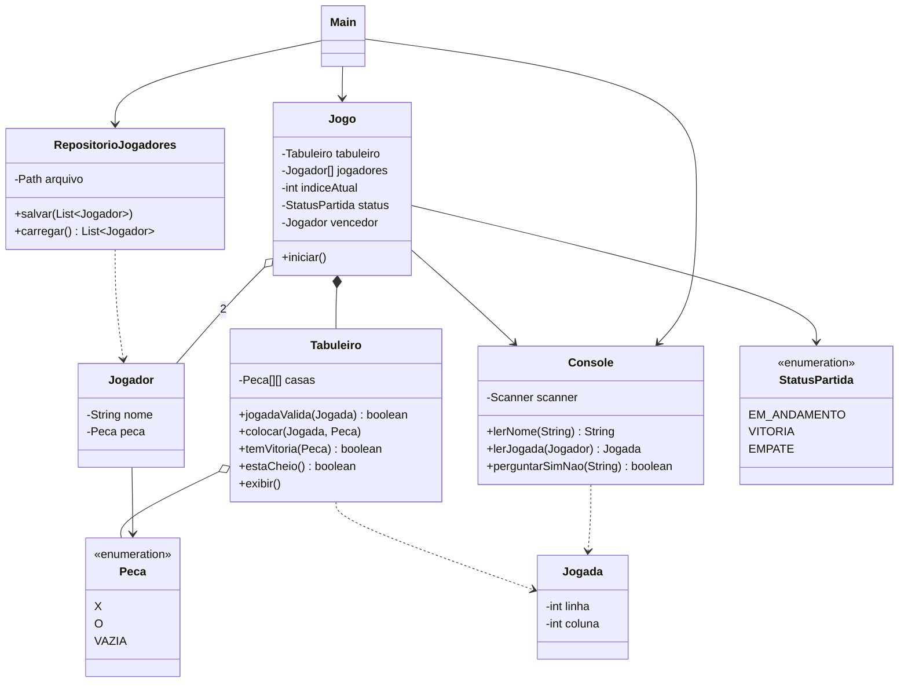

# Jogo-da-Velha# Jogo da Velha (Java, terminal)

Checkpoint 1 — O primeiro jogo

**Integrantes do grupo:**
- _Nome 1_
- _Nome 2_
- _Nome 3_

## Sobre o jogo

Jogo da Velha para dois jogadores, executado pelo terminal e feito em Java com orientação a objetos.

### Regras
- O tabuleiro tem 3 linhas e 3 colunas.
- O Jogador 1 usa **X** e o Jogador 2 usa **O**. Os jogadores se alternam, começando pelo X.
- Em cada turno, o jogador escolhe uma casa livre.
- Vence quem completar uma **linha**, uma **coluna** ou uma **diagonal** com a própria peça.
- Se o tabuleiro ficar cheio sem vencedor, a partida termina em **empate** ("deu velha").

### Funcionalidades
- Tabuleiro 3x3 exibido no terminal após cada jogada
- Dois jogadores com nome e peça
- Controle de turnos
- Validação das jogadas (formato digitado, casa fora do tabuleiro e casa ocupada)
- Condição de vitória e de empate
- Opção de jogar novamente e encerramento correto da partida
- Os jogadores são salvos em `jogadores.json` e podem ser reutilizados na próxima execução

## Requisitos

- Java 11 ou superior (para conferir, rode `java -version` e `javac -version` no terminal)

## Como compilar e executar

1. Abra o terminal **dentro da pasta do projeto** (a pasta que contém `src/` e este `README.md`).
2. Compile:

```bash
javac -d out src/*.java
```

3. Execute:

```bash
java -cp out Main
```

> Execute sempre os comandos a partir da mesma pasta. O arquivo `jogadores.json` é criado nela.

## Como jogar

1. Digite o nome do Jogador 1 (X) e do Jogador 2 (O).
   - Se existir um `jogadores.json` com dois jogadores salvos, o jogo pergunta se você quer reutilizá-los. Digite `s` para sim ou `n` para pedir novos nomes.
2. A cada turno, digite **linha e coluna** (de 1 a 3), separadas por espaço.
   - Exemplo: `2 3` marca a linha 2, coluna 3.
3. Ao final da partida, digite `s` para jogar de novo ou `n` para encerrar.

Exemplo de tela:

```
     1   2   3
   +---+---+---+
 1 | X | X | X |
   +---+---+---+
 2 | O |   |   |
   +---+---+---+
 3 | O |   |   |
   +---+---+---+
Vitória de Maria (X)!
Jogar novamente? (s/n):
```

## Estrutura do projeto

```
jogo-da-velha/
├── src/
│   ├── Main.java
│   ├── Jogo.java
│   ├── Tabuleiro.java
│   ├── Jogador.java
│   ├── Jogada.java
│   ├── Peca.java
│   ├── StatusPartida.java
│   ├── Console.java
│   └── RepositorioJogadores.java
├── docs/
│   └── diagrama-classes.puml
├── .gitignore
└── README.md
```

## Classes e responsabilidades

| Classe | Responsabilidade |
|---|---|
| `Main` | Ponto de entrada. Cria os jogadores (novos ou salvos) e inicia o `Jogo`. |
| `Jogo` | Controla a partida: turnos, jogada inválida, vitória, empate e jogar novamente. |
| `Tabuleiro` | Guarda as casas, valida jogadas, detecta vitória e tabuleiro cheio e exibe o tabuleiro. |
| `Jogador` | Guarda o nome e a peça do jogador. |
| `Jogada` | Representa a linha e a coluna escolhidas. |
| `Peca` | Enum com `X`, `O` e `VAZIA`. |
| `StatusPartida` | Enum com `EM_ANDAMENTO`, `VITORIA` e `EMPATE`. |
| `Console` | Isola toda a leitura do teclado (`Scanner`). |
| `RepositorioJogadores` | Salva e carrega os jogadores no arquivo `jogadores.json`. |

## Onde cada dado é armazenado

| Dado | Classe | Atributo |
|---|---|---|
| Os 2 jogadores | `Jogo` | `Jogador[] jogadores` |
| Nome e peça de cada jogador | `Jogador` | `nome`, `peca` |
| Jogador da vez | `Jogo` | `indiceAtual` |
| Tabuleiro | `Jogo` | `Tabuleiro tabuleiro` |
| Peças em cada casa | `Tabuleiro` | `Peca[][] casas` |
| Jogada digitada | `Jogada` | `linha`, `coluna` |
| Estado da partida | `Jogo` | `status` |
| Vencedor | `Jogo` | `vencedor` |
| Entrada do teclado | `Console` | `Scanner scanner` |
| Jogadores salvos em disco | `RepositorioJogadores` | arquivo `jogadores.json` |

### Formato do `jogadores.json`

```json
[
  {"nome": "Ana", "peca": "X"},
  {"nome": "Bia", "peca": "O"}
]
```

O arquivo é criado automaticamente na primeira execução. Não é preciso criá-lo manualmente.

## Diagrama de classes

O diagrama em PlantUML está em `docs/diagrama-classes.puml`.



## Demonstração

Roteiro sugerido para a apresentação:

1. Iniciar o jogo e informar os nomes dos jogadores.
2. Tentar uma jogada inválida: texto no lugar de número, casa fora do tabuleiro (`5 5`) e casa já ocupada.
3. Jogar até haver uma **vitória**.
4. Jogar de novo e forçar um **empate**.
5. Encerrar com `n`, abrir o jogo novamente e mostrar a pergunta para reutilizar os jogadores salvos.
